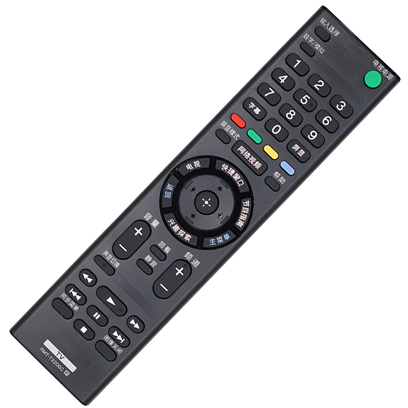
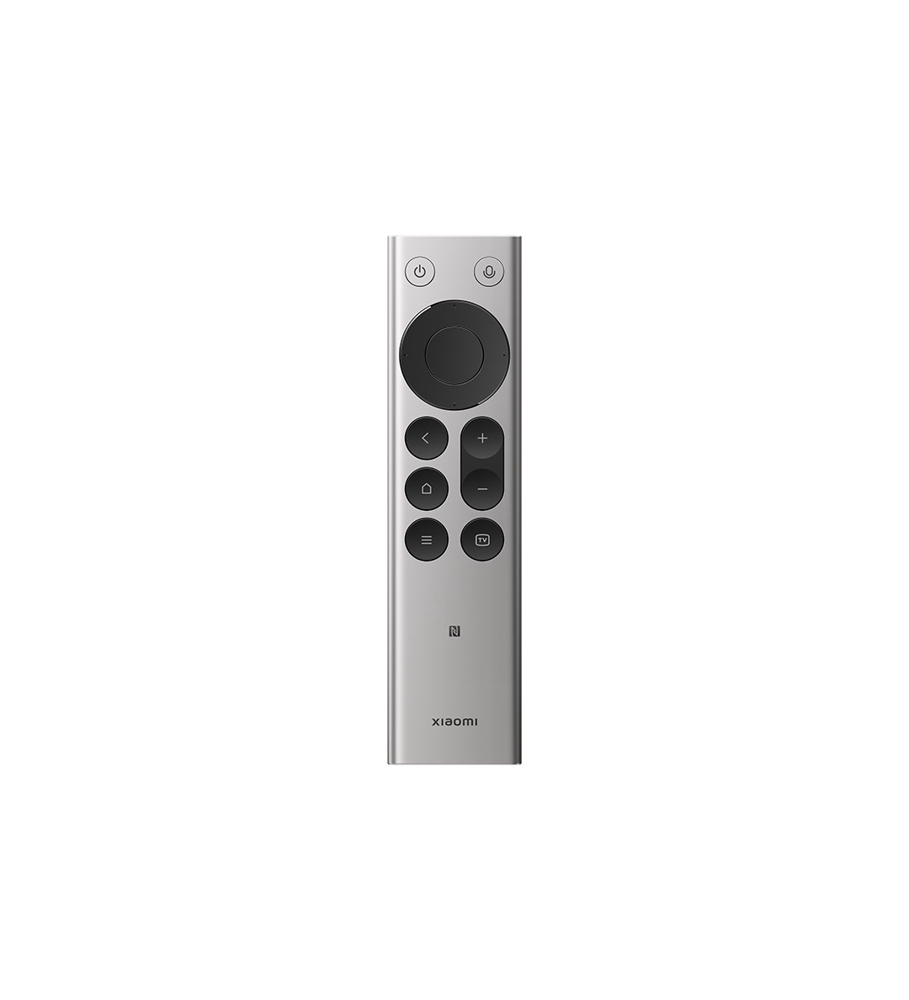

# Xiaomi Bluetooth Remote × Android TV

[简体中文](README.md) · **English** · [日本語](README.ja.md) · [한국어](README.ko.md) · [繁體中文](README.zh-TW.md) · [Deutsch](README.de.md)

> Full key support for the Xiaomi Bluetooth Remote (2 / 2 Pro) on any Android TV. Verified on Sony BRAVIA, no root required.

CleanYourTV gives Android TV an Apple-flavoured launcher — but it can't change how the remote feels in your hand. Apple TV's remote alone costs around US$200, and the closest hardware in the Android TV ecosystem is the Xiaomi Bluetooth Remote 2 / 2 Pro — 99 CNY new, about 60 CNY used in mint condition.

Out of the box, the two refuse to talk: Xiaomi only guarantees its remotes on Xiaomi TVs, and Sony's Bluetooth stack accepts first-party accessories only. This repo tears that wall down.

<table>
<tr>
<td align="center"><br><sub><b>Before</b> · Sony stock remote</sub></td>
<td align="center"><br><sub><b>After</b> · Xiaomi Bluetooth Remote 2 Pro</sub></td>
</tr>
</table>

## What works

| Key | Status | Notes |
|---|---|---|
| D-pad / OK / Back | ✅ Native | Standard HID keyboard usages, works right after pairing |
| Volume / Power | ✅ Native | Same as above |
| Home | ⚠️ Needs remap | The remote sends `KEYCODE_MOVE_HOME(122)` — the "move to line start" key for text fields. There are no text fields on a TV, so nothing happens |
| TV | ⚠️ Needs remap | Sends `KEYCODE_GRAVE(68)`, another key nobody listens to. This project maps it to "switch input" |
| Menu | ✅ | Firmware dependent, usually native |
| Voice | ❓ Unverified | The keycode is readable (`KEYCODE_F5(135)`), but the TV has no built-in microphone, so the audio capture half never worked. See below |

After the fix: **D-pad, OK, Back, Home, Volume, Menu, Power and TV (remapped to input switch) all work, and the remote reconnects by itself after a reboot.**

## The three walls (which is the whole project)

| What you'd assume | What's actually going on |
|---|---|
| The Xiaomi remote only works with Xiaomi TVs | It speaks standard BLE HID (HOGP), so any Bluetooth HID host can receive it. Only the voice key and a few vendor-specific keys are truly locked to Xiaomi |
| Sony whitelists Bluetooth devices, that's why scanning finds nothing | What's locked is not the stack but **the "Add accessory" screen in Settings** — it filters by device type, so third-party remotes never show up. The stack keeps scanning the whole time |
| Pairing succeeds, then nothing responds | Android 9 put `BluetoothHidHost.connect()` / `setPriority()` on the hidden-API blocklist. Plain reflection throws `NoSuchMethodException`, which looks exactly like "Sony deleted the method". Calling `VMRuntime.setHiddenApiExemptions("L")` first makes both work — the connection goes up immediately |

Here's what the first wall looks like — the spinner spins forever while the log keeps showing the device:


## Quick start

### Prerequisite: enable ADB on the TV (the only step you must do by hand)

An AI cannot do this for you, because it isn't connected to your TV yet.

**Sony BRAVIA (Android 9 / Google TV)**

1. `Settings → System → About`
2. Highlight **Version** and press OK **7 times** (some newer firmwares want 10 presses on **Android TV OS build**) until "You are now a developer" appears
3. Go back to `Settings → System → Developer options` and enable **USB debugging**; enable **Network debugging / ADB over network** too if present
4. Keep the TV awake — do not let it go to standby (some firmwares drop the debugging toggle on wake)

Then note the TV's LAN IP; your computer must be on the same subnet.

### Option A: let an AI do it (recommended)

This repo is also an agent skill: `SKILL.md` is the procedure the agent reads, `assets/` is the code it compiles, `scripts/tv.sh` is what it calls, and `references/pitfalls.md` is the list of dead ends it should not retry. Clone it into your skills directory:

```bash
git clone https://github.com/koukanana/openappletvremot ~/.workbuddy/skills/openappletvremot
```

(Claude Code users: put it in `~/.claude/skills/openappletvremot`. Any other agent just needs to be able to read the repo root.)

Then say:

> Use the openappletvremot skill to connect the Xiaomi Bluetooth Remote 2 Pro to this TV (192.168.x.x), and fix the Home and TV keys. Skill and code: https://github.com/koukanana/openappletvremot

It will then: connect ADB → build and install both tools → scan and pair by device-name keyword → lift the hidden-API restriction and bring up HID → write the key mapping → ask you to verify. You only touch three things: tap "Allow" on the TV, hold Home + Menu on the remote for 5 seconds, and press the keys to verify.

How the skill references itself (the agent just walks this chain):

```
prompt: "use the openappletvremot skill"
   └── SKILL.md          procedure §1–§6, each section points at a script or source file
        ├── scripts/tv.sh        connect / prep / pair / hid / keys / map / enable
        ├── assets/btpair/        pairing + hidden-API bypass + HID connect (Java)
        ├── assets/btremap/       accessibility key remapping (Java)
        ├── references/           Sony measurements, 13 dead ends
        └── docs/                 story version and technical version
```

### Option B: do it manually

```bash
# 0. Dependencies: adb + JDK + Android SDK build-tools / platform-28.
#    Missing them is fine — build_apk.sh downloads them into ~/.androidtv/sdk (~150MB, once)

# 1. Connect (the TV shows an authorization dialog, tap Allow)
./scripts/tv.sh <TV_IP> connect
./scripts/tv.sh <TV_IP> info

# 2. Build and install both tools, and enable the remap service
./scripts/tv.sh <TV_IP> prep

# 3. Put the remote into pairing mode: hold Home + Menu for 5s until the LED flashes fast,
#    then scan and pair by name keyword (no MAC address needed; 8 rounds × 20s)
./scripts/tv.sh <TV_IP> pair

# 4. Verify HID is up: mInputDevices should show : 2, dumpsys input should list an eventN
./scripts/tv.sh <TV_IP> hid

# 5. Write the mapping and enable it (Home → launcher, TV → Sony input selection)
./scripts/tv.sh <TV_IP> map '122>g>2;68>k>com.sony.dtv.tvx/com.sony.dtv.tvx.inputselect.InputSelectionActivity:178'
./scripts/tv.sh <TV_IP> enable
```

Rebuild the APKs only, without touching the TV:

```bash
./scripts/build_apk.sh assets/btpair  release/btpair.apk
./scripts/build_apk.sh assets/btremap release/btremap.apk
```

Mapping format: `source_keycode>action>argument`, separated by `;`. Actions: `g` = global action (1 back / 2 home / 3 recents / 4 notifications), `a` = launch activity, `k` = launch activity with a key event, `s` = assist intent.

For other TV brands, replace the `k` action's activity with that brand's input-selection screen. Details in `references/sony-bravia.md`.

## How it works

Two APKs, under 20KB combined, neither needs root:

- **BTPair** (`assets/btpair`): reflects into `BluetoothAdapter.startDiscovery` + `createBond` to pair, then `BluetoothHidHost.setPriority(100)` / `connect()` to register the remote as a standard input device. The one crucial line is the hidden-API exemption — without it, `connect()` always throws `NoSuchMethodException`.
- **BTRemap** (`assets/btremap`): a stripped-down `AccessibilityService` declaring `CAPABILITY_CAN_REQUEST_FILTER_KEY_EVENTS`. It can only do two things: perform a global action (`GLOBAL_ACTION_HOME` etc.), or launch an activity (optionally with a `KEY_EVENT` extra). The mapping lives in `Settings.Secure.btremap_map` and applies instantly, no reboot.

Why not "intercept key A and emit key B": `INJECT_EVENTS` is a signature permission that third-party apps cannot hold. So the ceiling for remapping is "global action + launch activity" — and Home and TV both happen to fit.

## About the voice key (unverified, not impossible)

Known facts: this TV has **no built-in microphone** — `/proc/asound/cards` is empty, `audio_policy` lists no input devices, and `pm list features` only has `android.hardware.audio.output`. Sony's voice pipeline is "remote mic → Bluetooth back-channel → TV recognition", so mapping the voice key to "start voice" may bring up the UI, but there is nothing on the TV side to capture audio.

The key itself works (it reports `KEYCODE_F5(135)`), and handling is identical to the TV key: `135>s>` maps it to `ACTION_ASSIST`. What's actually stuck is audio. If you want to push it further, PRs are welcome.

## Rollback

```bash
# Restore original key behaviour immediately
adb shell settings put secure enabled_accessibility_services ''

# Uninstall (the pairing stays, the remote still works, keys just revert)
adb uninstall com.atvremote.remap
adb uninstall com.atvremote.pair
```

Finally, on the TV: `Settings → Developer options → Revoke USB debugging authorizations`. **ADB on port 5555 is plaintext — turn it off when you're done.**

## Layout

```
SKILL.md                    agent skill entry point (the procedure the AI follows)
scripts/tv.sh               one-liner wrapper: connect/pair/keys/map/enable and friends
scripts/build_apk.sh        Gradle-free build: aapt2 → javac → d8 → zipalign → apksigner
assets/btpair/              pairing + HID activation (source)
assets/btremap/             accessibility key remapping (source)
release/                    prebuilt APKs (debug-signed, for personal use)
references/sony-bravia.md   Sony menu paths, input-selection activity, adb probes
references/pitfalls.md      13 verified dead ends, so you don't retry them
docs/让小米强兼索尼.md        story version: why and how (Chinese)
docs/完整指南.md             technical version: step by step + full prompt (Chinese)
```

## Compatibility

- Android 8.0+ (the hidden-API blocklist exists since API 28; verified on 9.0), Android TV or Google TV
- Remote: Xiaomi Bluetooth Remote 2 Pro (verified), Xiaomi Bluetooth Remote 2 (same architecture, should work, untested)
- TV: Sony BRAVIA 2018–2020 (verified). Other brands follow the same principle; only the input-selection activity differs
- Host: macOS verified. On Linux/Windows just bring your own adb and build-tools

## Help other TV brands

This only runs on Sony BRAVIA so far. Every other brand (TCL, Hisense, Skyworth, Xiaomi TV, Shield, Chromecast with Google TV…) works the same way — the only two differences are **the activity name of the input-selection screen** and **a handful of keycodes**.

If you own another TV, pull requests are very welcome: test it, then add a `references/<brand>.md` with your measurements (menu paths, input-selection activity, keycode table) and the model plus OS version. The code most likely needs no changes at all.

## Disclaimer

You're modifying the Bluetooth pairing and system settings of your own TV. At your own risk: it may affect warranty claims, leave stale pairings, or need redoing after a system update. Don't try this on a shared or production device. Code is MIT — fork it, break it, don't blame me.

## License

MIT
